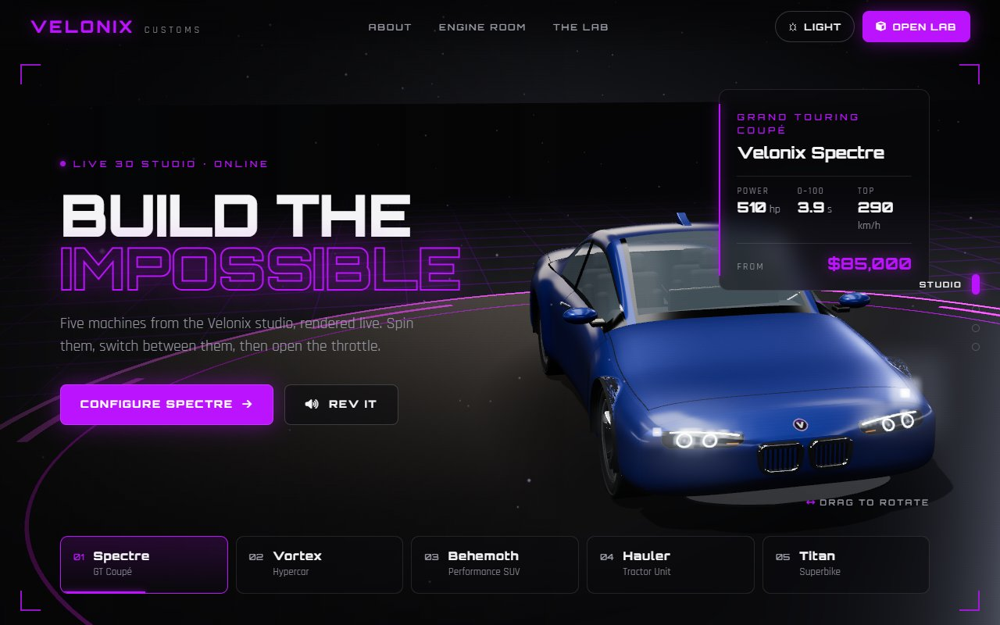
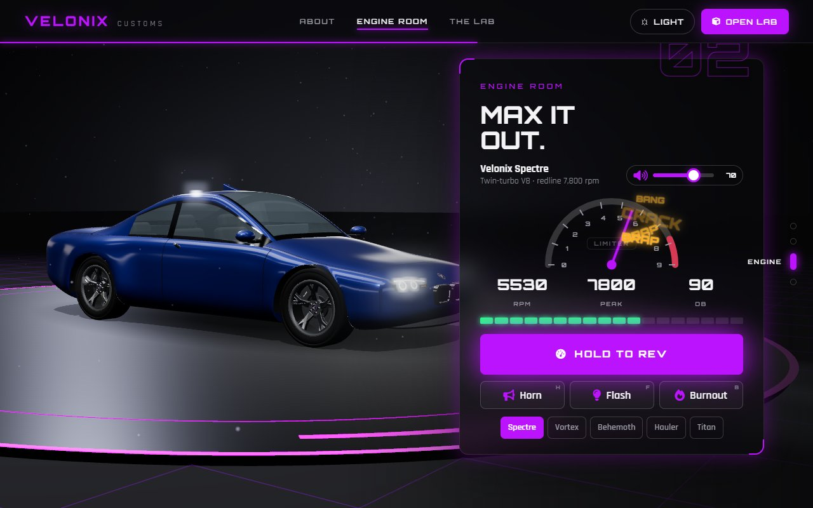
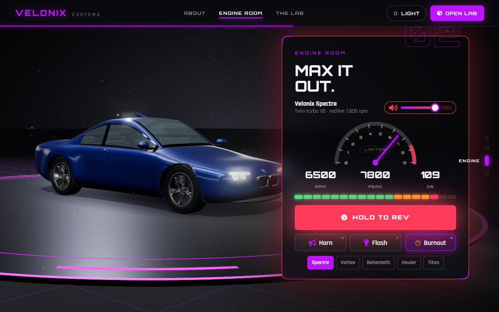
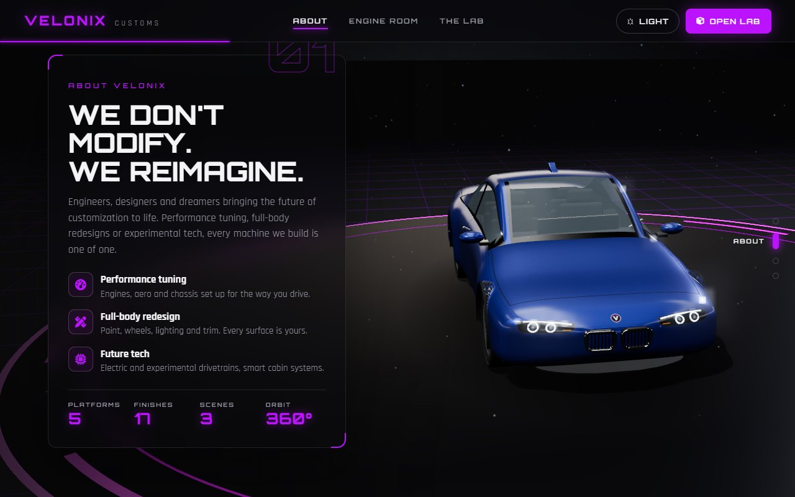
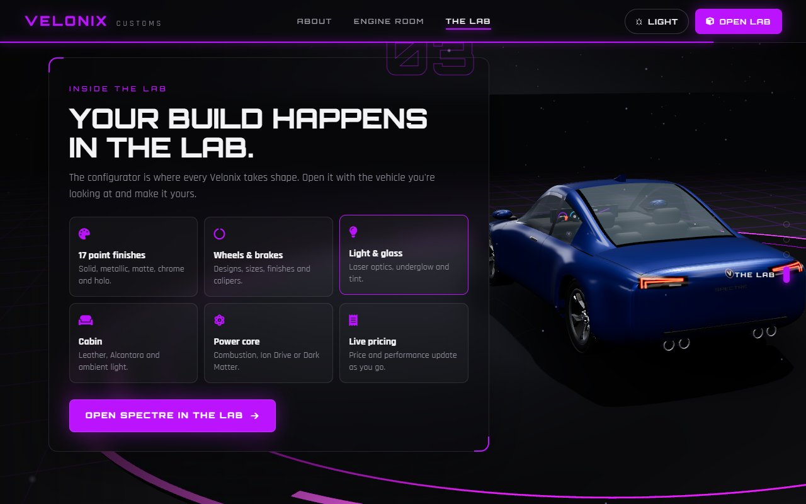
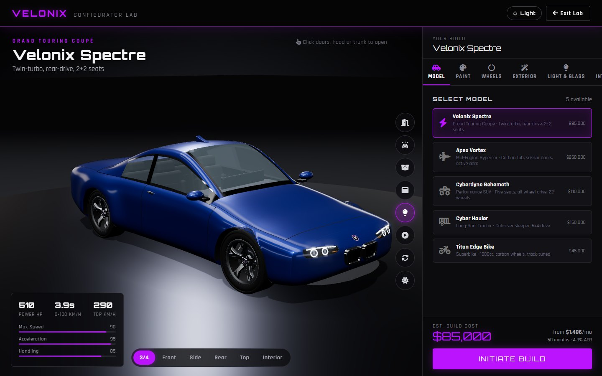
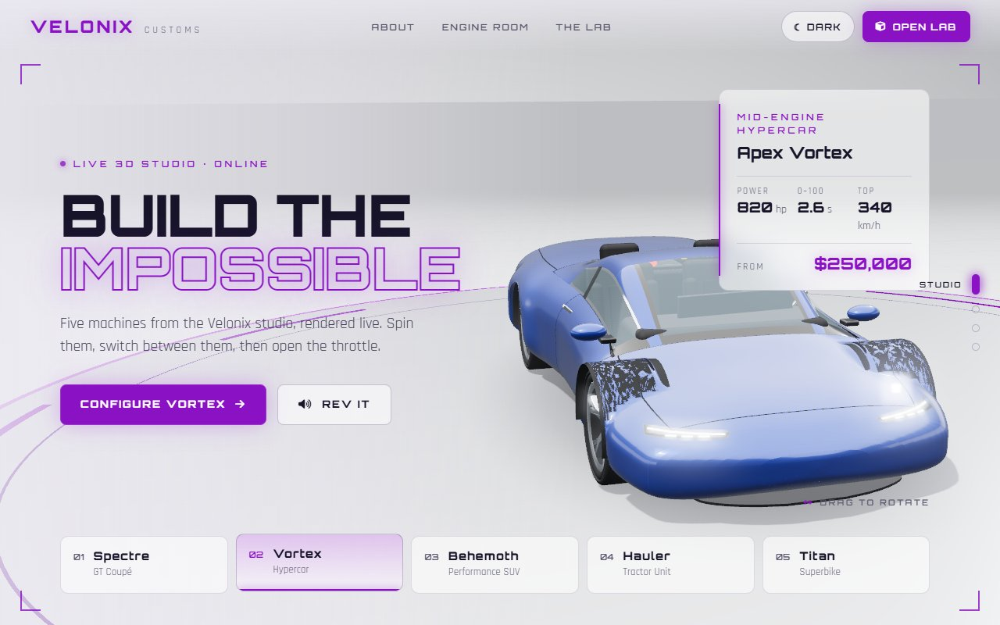
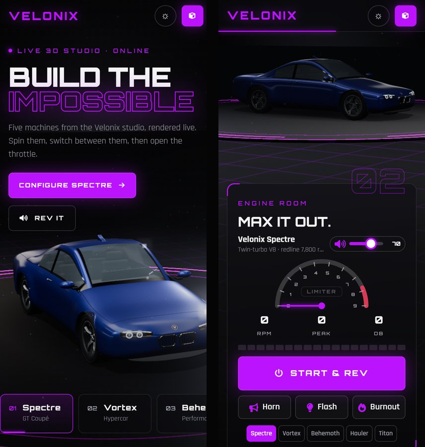

# 🚗 Velonix Car Configurator (3D Web App)

An interactive 3D vehicle customization platform that allows users to design and visualize vehicles in real-time.

**🌐 Live demo: [velonixsun.vercel.app](https://velonixsun.vercel.app)**


*Live 3D hero → drag to rotate and switch models → rev it in the Engine Room, crank the volume to MAX, flash the lights and do a burnout → open the vehicle in the configurator.*

## 🔥 Overview
Velonix is a futuristic web-based configurator where users can:
- Select different vehicle models
- Customize colors, wheels, and engine types
- View real-time price updates
- Interact with a dynamic 3D environment

The home page is a live 3D showroom: the same Three.js studio that powers the configurator runs full-screen behind the page and the camera glides to a new angle for each section. It introduces the studio and has an **Engine Room** where you can rev each vehicle; all customizing happens in the configurator (the Lab).

This project demonstrates front-end development, UI/UX design, and 3D rendering using JavaScript.

---

## 🛠️ Tech Stack

- HTML5
- CSS3
- JavaScript (ES6)
- Three.js (3D Rendering)
- Lenis (smooth scrolling)
- Font Awesome (Icons)

---

## ⚙️ Features

- 🎨 Real-time vehicle customization
- 🚘 Multiple vehicle types (cars, bikes, trucks, and SUVs)
- 💰 Dynamic pricing system
- 📊 Live performance stats (speed, acceleration, handling)
- 🛰️ Live 3D home page: drag to rotate, switch models, scroll-driven camera
- 🔊 Engine Room: hold to rev into the limiter, exhaust crackle on lift-off, volume up to MAX, horn, headlight flash and burnout, with a different engine note per vehicle (V8, V12, diesel, inline-4)
- 🔗 The vehicle on screen opens straight in the configurator
- 🎥 Interactive 3D rendering with orbit controls, interior views and materialize effects
- 🌗 Dark and light themes shared across pages
- 📱 Responsive design

---

## 📸 Screenshots

### Home: live 3D showroom



### Engine Room
Hold to rev (or press Space) and bounce it off the limiter, lift off for the crackle, and turn the volume all the way to MAX. Horn (H), Flash (F) and Burnout (B) make the 3D car react: the headlights blink, the wheels spin and the camera shakes with the revs. The engine sound is synthesized live with Web Audio.

| Revving | Volume at MAX + burnout |
|---------|-------------------------|
|  |  |

### About and the Lab

| About | The Lab |
|-------|---------|
|  |  |

### 3D Configurator Lab
Paint, wheels, lighting, interior and engine options with live pricing and performance stats.



### Light Theme
The theme choice is shared between the home page and the configurator.



### Mobile

<p align="center"></p>

---

## 🚀 Live Demo

👉 **[velonixsun.vercel.app](https://velonixsun.vercel.app)**, deployed on Vercel from the `main` branch.

| Page | Link |
|------|------|
| Home | [velonixsun.vercel.app](https://velonixsun.vercel.app) |
| Configurator | [velonixsun.vercel.app/customize.html](https://velonixsun.vercel.app/customize.html) |

---

## 📂 Project Structure
```
velonix-car-configurator/
│── index.html        # Home: live 3D showroom, About, Engine Room, Lab intro
│── customize.html    # 3D configurator lab (self-contained; ?showroom=1 = canvas-only mode used by Home)
│── site.css          # Home page styles
│── site.js           # Home page logic: drives the embedded 3D studio and the Engine Room sound
│── customcar1.png    # Poster shown if WebGL is unavailable
└── screenshots/      # README screenshots
```


---

## 🧠 What I Learned

- Working with 3D graphics using Three.js  
- Managing application state in JavaScript  
- Building interactive UI components  
- Driving an embedded 3D scene from page scroll  
- Synthesizing engine sound with the Web Audio API  

---

## 🔧 Future Improvements

- Save user configurations (localStorage)
- Backend integration for real orders
- User authentication system
- Database for storing builds
- Improved mobile responsiveness

---

## 👤 Author

Sudasun
- GitHub: https://github.com/SUDARSUN-24
- Portfolio: (add later)

---

## 📄 License
This project is for educational and portfolio purposes.
