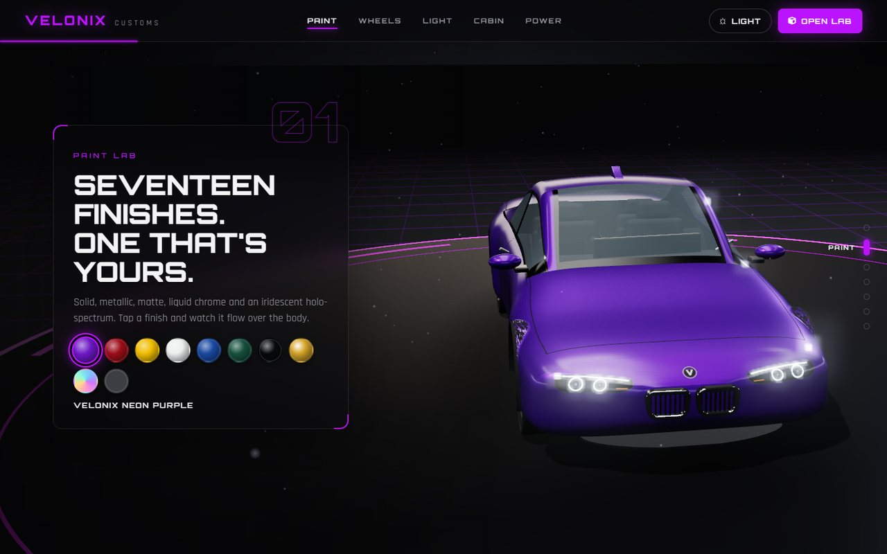
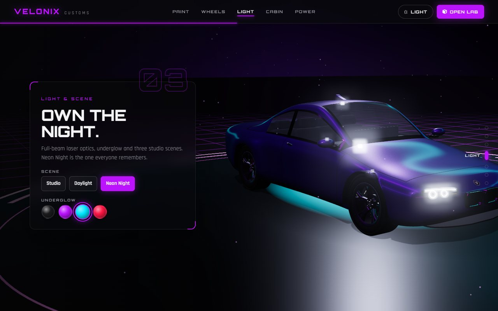
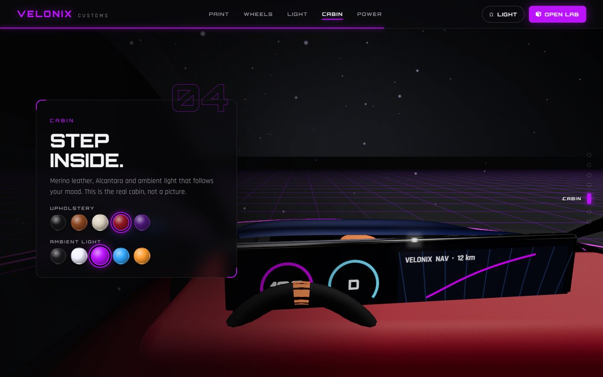
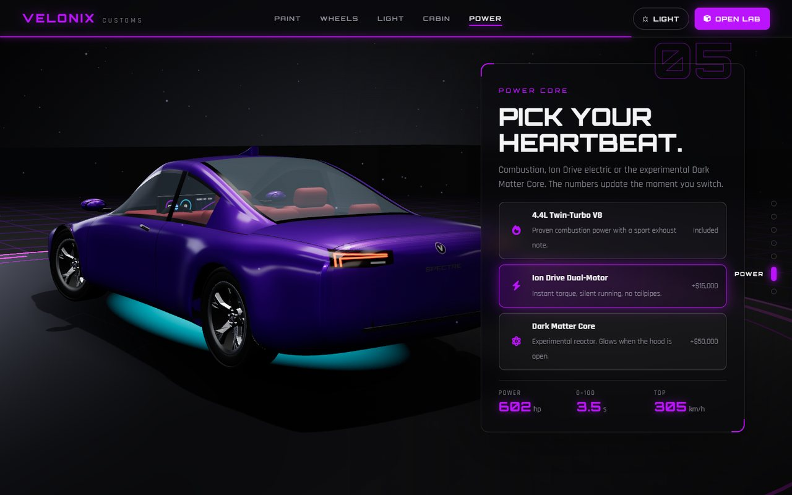

# 🚗 Velonix Car Configurator (3D Web App)

An interactive 3D vehicle customization platform that allows users to design and visualize vehicles in real-time.

**🌐 Live demo: [velonixsun.vercel.app](https://velonixsun.vercel.app)**


*Live 3D hero → drag to rotate and switch models → scroll through Paint, Wheels, Light, Cabin and Power → carry the build into the configurator.*

## 🔥 Overview
Velonix is a futuristic web-based configurator where users can:
- Select different vehicle models
- Customize colors, wheels, and engine types
- View real-time price updates
- Interact with a dynamic 3D environment

The home page is a live 3D showroom: the same Three.js studio that powers the configurator runs full-screen behind the page, and scrolling flies the camera through each customization chapter.

This project demonstrates front-end development, UI/UX design, and 3D rendering using JavaScript.

---

## 🛠️ Tech Stack

- HTML5
- CSS3
- JavaScript (ES6)
- Three.js (3D Rendering)
- Lenis (smooth scrolling)
- Font Awesome (Icons)

---

## ⚙️ Features

- 🎨 Real-time vehicle customization
- 🚘 Multiple vehicle types (cars, bikes, trucks, and SUVs)
- 💰 Dynamic pricing system
- 📊 Live performance stats (speed, acceleration, handling)
- 🛰️ Live 3D home page: drag to rotate, switch models, scroll-driven camera through each chapter
- 🔗 Picks made on the home page carry straight into the configurator
- 🎥 Interactive 3D rendering with orbit controls, interior views and materialize effects
- 🌗 Dark and light themes shared across pages
- 📱 Responsive design

---

## 📸 Screenshots

### Home: live 3D showroom


### Scroll chapters
Each chapter moves the camera and lets you change the car right on the page.

| Paint | Light & Scene |
|-------|---------------|
|  |  |
| **Cabin** | **Power** |
|  |  |

### 3D Configurator Lab
Paint, wheels, lighting, interior and engine options with live pricing and performance stats.


### Light Theme
The theme choice is shared between the home page and the configurator.


### Mobile

<p align="center"></p>

---

## 🚀 Live Demo

👉 **[velonixsun.vercel.app](https://velonixsun.vercel.app)**, deployed on Vercel from the `main` branch.

| Page | Link |
|------|------|
| Home | [velonixsun.vercel.app](https://velonixsun.vercel.app) |
| Configurator | [velonixsun.vercel.app/customize.html](https://velonixsun.vercel.app/customize.html) |

---

## 📂 Project Structure
```
velonix-car-configurator/
│── index.html        # Home: live 3D showroom with scroll chapters
│── customize.html    # 3D configurator lab (self-contained; ?showroom=1 = canvas-only mode used by Home)
│── site.css          # Home page styles
│── site.js           # Home page logic: drives the embedded 3D studio
│── customcar1.png    # Poster shown if WebGL is unavailable
└── screenshots/      # README screenshots
```


---

## 🧠 What I Learned

- Working with 3D graphics using Three.js  
- Managing application state in JavaScript  
- Building interactive UI components  
- Driving an embedded 3D scene from page scroll  

---

## 🔧 Future Improvements

- Save user configurations (localStorage)
- Backend integration for real orders
- User authentication system
- Database for storing builds
- Improved mobile responsiveness

---

## 👤 Author

Sudasun
- GitHub: https://github.com/SUDARSUN-24
- Portfolio: (add later)

---

## 📄 License
This project is for educational and portfolio purposes.
